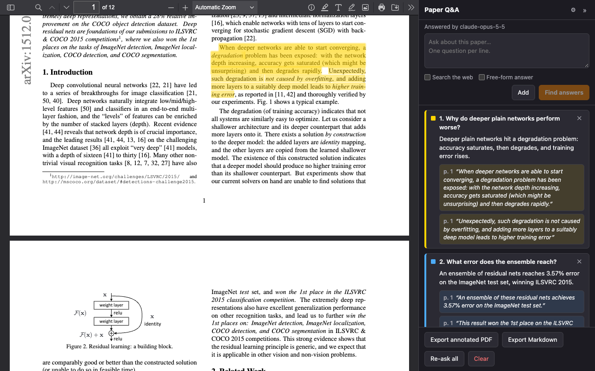

# Paper Q&A

[](https://github.com/mohph197/pdf-qna/actions/workflows/ci.yml)
[](https://github.com/mohph197/pdf-qna/releases/latest)
[](LICENSE)

A Chrome extension (Manifest V3) for asking Claude questions about a research-paper PDF. Answers come back with verbatim supporting quotes, which are highlighted in the PDF, with one color per question.

- Opens PDFs in a bundled copy of Mozilla's pdf.js viewer (v6.4.299), because Chrome's built-in viewer can't be scripted.
- A sidebar shows your questions, Claude's short answers and 1–3 quotes per answer. Click a quote to scroll to its highlight and flash it.
- Quotes are matched to the text layer by a matcher that tolerates hyphenation, ligatures, smart quotes, dashes, line breaks, page breaks and small wording differences. Approximate and low-confidence matches are labeled in the sidebar.
- Tick **Search the web** before adding a question to let Claude also search the web for it, for example for later work, released code or the current state of a result. Answers then list the web pages they rely on, each with a link and a supporting quote. Only pages that a search actually returned are shown.
- Tick **Free-form answer** for requests that don't fit a short quoted answer, such as "list every dataset as a Markdown table" or "extract the hyperparameters as JSON". The whole input box becomes one request, Claude answers in the format you ask for, and quotes become optional (it still adds them where they directly support the answer). Free-form answers keep their line breaks and have a **Copy answer** button.
- **Export annotated PDF** saves a copy with the highlights written in as real PDF Highlight annotations, so they show in Acrobat, Preview, Chrome and other readers.
- **Export Markdown** saves the questions, answers and quotes, with page numbers and match notes, as a `.md` file for your notes.
- **Citation previews.** Click a citation such as `[41]` or `(Peters et al., 2018)` and a card shows the cited paper instead of jumping to the reference list: title, authors, venue and year, citation count, a one-sentence summary, the abstract, and links to Google Scholar, Semantic Scholar, arXiv, the DOI and the PDF. **Open in Paper Q&A** opens the cited paper in a new tab. **Go to reference** still jumps to the bibliography entry, and Ctrl/⌘-click keeps the old behavior.
- **Paper info.** The ⓘ button in the viewer's toolbar shows the same card for the open paper, with a **Copy BibTeX** button.
- **Default PDF viewer.** Set "When a PDF opens" to **Always** (or click **Always** on the banner) and PDFs open straight in Paper Q&A, including local files. The address bar shows the PDF's own URL, as `chrome-extension://<id>/https://arxiv.org/pdf/…`, so you can still read, copy and reload it.
- Results are cached per file (by SHA-256 hash). Reopening a paper restores its questions and highlights without a new API call.



Paper Q&A is an independent project and is not affiliated with or endorsed by Anthropic.

## Install

**From the Chrome Web Store:** coming soon.

**From a release:** download `paper-qa-<version>.zip` from the [latest release](https://github.com/mohph197/pdf-qna/releases/latest) and unzip it. Then follow the steps below, selecting the unzipped folder.

**From source:** no build step is needed. The repository already contains the vendored libraries.

1. Open `chrome://extensions`.
2. Turn on **Developer mode** (top right).
3. Click **Load unpacked** and select the folder that contains `manifest.json`.
4. Optional, for local PDFs: on the extension's **Details** page, turn on **Allow access to file URLs**. Without this, `file://` PDFs can't be read. You can still drag a file into the viewer or use its open-file button.

## Setup

1. Click the extension's toolbar icon and choose the ⚙ in the sidebar, or right-click the icon and choose **Options**.
2. Paste your Anthropic API key (create one at [console.anthropic.com](https://console.anthropic.com/settings/keys)). It is stored only in `chrome.storage.local`, used only by the background service worker, and sent only to `api.anthropic.com`.
3. Pick a model. **Test key & load models** checks the key and lists every model it can use.
   - `claude-opus-5-5` (default): best answers, $4 per million input tokens.
   - `claude-sonnet-5-5`: faster and cheaper.
   - `claude-haiku-5-5`: fastest and cheapest.
   - `claude-fable-5-1`: most capable, most expensive.
4. Optionally set **Effort** (default: medium) and choose what happens when a PDF opens: offer, always open (Paper Q&A becomes Chrome's PDF viewer), or do nothing.
5. Optionally paste a free [Semantic Scholar API key](https://www.semanticscholar.org/product/api#api-key-form) for citation previews and paper info. They work without one, but keyless requests share a public rate limit and can fail at busy times.

A typical 10–15 page paper is around 15–20k tokens, which is a few cents per question batch with Opus 5.5. The sidebar shows an estimate for each paper. The paper text is sent with prompt caching, so follow-up questions on the same paper within a few minutes cost much less.

## Use

- Open any PDF in Chrome. Paper Q&A detects it by URL or by `Content-Type: application/pdf`, so `arxiv.org/pdf/…` URLs work. It then shows an **Open in Paper Q&A** banner (or a notification if the banner can't be shown) and a "Q&A" badge on the toolbar icon. Clicking the toolbar icon also opens the current PDF.
- You can also right-click a link and choose **Open PDF in Paper Q&A**.
- Click a citation in the paper to preview the cited paper, or the ⓘ toolbar button for the open paper. Esc or a click elsewhere closes the card. Turn previews off on the options page to make citations jump to the reference list again.
- Type one or more questions, one per line, and press **Add** (⌘/Ctrl+Enter). Then press **Find answers**. Only unanswered questions are sent. **Re-ask all** sends them all again.
- Questions added with **Search the web** ticked are tagged "web". Claude may run up to 5 searches per request for them, billed by Anthropic at $10 per 1,000 searches on top of tokens. Your organization's admin can turn web search off in the Claude Console; the sidebar then explains the error.
- Quote badges in the sidebar:
  - no badge: exact match.
  - `≈ 93%`: close match (for example, the model changed a word).
  - `⚠ low confidence`: weak match. The highlight also gets a striped pattern; check it yourself.
  - `not found in text`: no highlight was made.

## How it works

```text
manifest.json
background/service-worker.js   PDF detection, offer banner, context menu, message routing
background/claude.js           Messages API client: streaming, retries, error mapping
background/scholar.js          Semantic Scholar client for citation previews and paper info
shared/models.js               model list, defaults, settings
shared/prompt.js               system prompt, JSON schema, response validator
lib/matcher.js                 quote matcher (pure ES module, also runs in Node)
lib/references.js              finds a citation's bibliography entry and the open paper's identity
src/viewer/boot.mjs            runs before pdf.js to take over document loading
src/viewer/qa.mjs, qa.css      sidebar, highlighting, cache, export trigger
src/viewer/papers.mjs          citation preview cards and the toolbar's paper info button
src/viewer/dom.js              h(), the small DOM helper the viewer builds its UI with
src/viewer/export.js           writes /Highlight annotations with pdf-lib
src/viewer/markdown.js         renders questions, answers and quotes as Markdown
options/                       settings page
vendor/pdfjs/, vendor/pdf-lib/ pinned upstream builds (pdf.js 6.4.299, pdf-lib 1.17.1)
scripts/vendor.sh              re-downloads vendor/ and patches viewer.html (one command)
tests/matcher-test.mjs         matcher stress test on real arXiv PDFs
tests/references-test.mjs      citation-to-reference test on real arXiv PDFs
tests/e2e.mjs                  end-to-end test in headless Chrome (mocked APIs)
scripts/package.sh             builds dist/paper-qa-<version>.zip for the store
scripts/cws-publish.mjs        uploads a package to the Chrome Web Store (used by CI)
store/                         store listing text, screenshots and promo images
```

**API request.** The viewer extracts every page's text with pdf.js and sends it to the service worker over a long-lived port. The service worker calls `POST https://api.anthropic.com/v1/messages` with these headers: `x-api-key`, `anthropic-version: 2023-06-01` and `anthropic-dangerous-direct-browser-access: true`. The request streams the response, asks for structured JSON output, and sets `fallbacks: "default"`, which reruns the request on another model if a safety classifier declines it (Opus, Sonnet and Fable models only). The reply must match this schema:

```json
{
  "answers": [
    {
      "question_index": 1,
      "answerable": true,
      "answer": "Short answer.",
      "quotes": [{ "text": "Verbatim sentence from the paper…", "page": 4 }],
      "web_sources": []
    }
  ]
}
```

Questions with **Free-form answer** on are marked `[free-form]`: their `answer` may take any format and length, `quotes` may be empty even when `answerable` is `true`, and the request allows 32k output tokens instead of 16k. When a question has web search on, the request also includes Anthropic's server-side `web_search` tool (`web_search_20260209`, or the basic `web_search_20250305` for models without dynamic filtering) and the question is marked `[web search allowed]`. Claude then fills `web_sources` with `{ url, title, quote }` entries. The service worker rebuilds the streamed content blocks so a paused turn (`pause_turn`) can be resumed, records every search result and citation URL, and drops any web source whose URL no search returned. When the paper doesn't answer a question, `answerable` is `false`, `answer` says what the paper does or doesn't cover, and `quotes` is empty. The reply is validated; if it is malformed, the extension retries once and shows Claude what was wrong. Errors get clear messages: missing or invalid key, unknown model, rate limits (with automatic retry when the wait is short), API overload, refusals, and PDFs too long for the model's context window (checked before sending as well).

**Matcher.** Both the page text and each quote are reduced to a key: NFKC-normalized (this expands ligatures like fi and turns math letters like 𝑥 into plain letters), accents stripped, lower-cased, and only letters and digits kept. Whitespace, line breaks, hyphenation, dashes and quote marks therefore can't cause a mismatch. Every key character records the text-layer item and character offset it came from. The matcher then tries, in order:

1. An exact key match. When there are several, it picks the one nearest the page the model gave. Matches can span any number of spans and cross page breaks.
2. A match that ignores digits, which covers dropped citation numbers like `[12]` and footnote markers.
3. If the quote contains `...`, a match of each piece separately, but only when the quote doesn't match as a whole (`...` can be literal text, such as table-of-contents leaders).
4. A fuzzy match. Candidate regions are found by k-gram voting, then the quote is aligned against each region with an edit-distance alignment. A score of 0.9 or more counts as approximate, 0.7–0.9 as low confidence, and anything lower as not found.

The matched key range is mapped back to `(page, item, start, end)` segments. When pdf.js renders a page's text layer (on scroll or zoom), the affected spans are split and the matched characters are wrapped in colored `<span>`s. Highlights are reapplied every time a page re-renders.

**Citation previews and paper info.** A click on an internal link is caught before pdf.js follows it. The link's destination is resolved to a page and position. If it is a citation, the bibliography entry is read from the text items below that position, up to where the next entry starts. A citation is a hyperref `cite.*` destination, or a target after the "References" heading that looks like an entry. Entries are recognized by labels like `[12]`, by hanging indents, and by entries that continue in the next column or on the next page. From the entry's text the viewer takes a DOI, an arXiv ID or a title guess: the first sentence after the author list, skipping a year, or a quoted title. The service worker looks it up with the [Semantic Scholar Academic Graph API](https://api.semanticscholar.org/api-docs/graph): `GET /paper/DOI:…` or `/paper/ARXIV:…`, otherwise `/paper/search/match?query=<title>`. A title match is accepted only if at least 80% of its words occur in the entry. The open paper is identified from its URL (arXiv, ACL Anthology, DOI), the arXiv stamp or a DOI on page 1, the PDF's title metadata, or the largest text on page 1. Lookups are made only when you click. Requests that get a 429 or 5xx are retried twice. Results are kept for the session.

**Readable URLs and the default viewer.** The viewer opens as `viewer.html?src=<PDF URL>` and then uses `history.replaceState` to change its address to `chrome-extension://<id>/<PDF URL>`. When that address is loaded again (reload, history, a copied link), the service worker's `fetch` handler redirects it to the viewer. If a hard reload bypasses the service worker, a tab listener catches the resulting error page. `boot.mjs` turns pdf.js's relative resource paths (worker, fonts, CMaps) into absolute ones so they don't follow the changed address. In **Always** mode, the `webRequest` listener that recognizes PDFs also sends the tab to the viewer as soon as the response headers arrive, before Chrome's viewer shows the file. Local PDFs are caught when their tab starts loading. The tab remembers the PDF it last opened this way, so going Back to it shows the PDF instead of reopening the viewer.

## Development and tests

Node 20+ and Chrome are needed. npm is only used for dev tooling.

```sh
npm install
npm test            # static checks, matcher test, end-to-end test
npm run package     # dist/paper-qa-<version>.zip
```

- `npm run check` runs static checks: JS syntax, manifest and package versions match, every referenced file exists, and the vendored viewer is patched.
- `npm run test:matcher` runs the matcher stress test (it downloads three arXiv papers). It cuts random passages out of each paper's text layer, distorts them the way model quotes tend to differ (typography changes, extra line breaks, dropped citations, `...` elisions, a few changed or deleted words, passages crossing a page break), and checks that the highlight lands on the original characters. Current results on ResNet (1512.03385), BERT (1810.04805) and GPT-3 (2005.14165): 1250/1260 passages found. All of the misses are in tables of contents, tables or figure labels, where the text is mostly dot leaders or repeated tokens. Text that doesn't occur in the paper is correctly reported as not found.
- `npm run test:references` checks reference parsing and paper IDs with unit cases, then follows every citation link in the three test papers (250 citations). Each one must lead to its whole bibliography entry and nothing more, and must yield a DOI, arXiv ID or title.
- `npm run test:e2e` loads the extension into headless Chrome with mocked Claude and Semantic Scholar APIs and checks the whole flow: answering, highlights, quote navigation, zoom, cache restore, PDF and Markdown export, local files, the open-PDF banner, readable URLs (including a reload), "always open" mode, the paper info card and citation previews. Set `CHROME_PATH` if Chrome isn't in a standard location, and `EXTENSION_DIR` to test an unzipped package.
- `npm run store-assets` regenerates the icons, store screenshots and promo tiles.

CI (`.github/workflows/ci.yml`) runs all of this on every push and pull request. It runs the end-to-end test against the built store package and uploads that package as an artifact.

## Contributing and releasing

`main` is protected: changes go through pull requests, which need the **Check, test and package** CI job to pass before they can be merged. PRs are squash-merged, so **the PR title becomes the commit message** and must follow [Conventional Commits](https://www.conventionalcommits.org/). A check enforces this:

| PR title | Effect on the next release |
| --- | --- |
| `fix: …` / `fix(matcher): …` | patch (1.0.0 → 1.0.1) |
| `feat: …` | minor (1.0.0 → 1.1.0) |
| `feat!: …`, or a `BREAKING CHANGE:` footer | major (1.0.0 → 2.0.0) |
| `docs:`, `chore:`, `ci:`, `test:`, `refactor:` | no release on their own |

Releases are automated with [release-please](https://github.com/googleapis/release-please-action):

1. After a `feat:` or `fix:` PR is merged, release-please opens (or updates) a PR titled **chore: release X.Y.Z**. It bumps the version in `manifest.json`, `package.json` and `package-lock.json` and adds the changes to `CHANGELOG.md`.
2. Leave that PR open while more changes land; it keeps itself up to date. When you want to ship, merge it.
3. Merging it creates the `vX.Y.Z` tag and GitHub release, then runs the **Release** workflow. That workflow tests the build, attaches `paper-qa-X.Y.Z.zip` to the release and, if set up, publishes to the Chrome Web Store.

For a one-off manual release, you can still bump the versions yourself and push a `vX.Y.Z` tag.

### Chrome Web Store publishing setup (one time)

The first version has to be submitted by hand:

1. Register at the [Chrome Web Store Developer Dashboard](https://chrome.google.com/webstore/devconsole) (one-time $5 fee; the Google account needs 2-step verification).
2. Click **New item** and upload `paper-qa-<version>.zip` from the GitHub release.
3. Fill in the **Store listing**, **Privacy** and **Distribution** tabs using [`store/LISTING.md`](store/LISTING.md) and the images in [`store/`](store). Then **Submit for review**.

To let CI publish later versions:

1. In Google Cloud, enable the **Chrome Web Store API**, create an OAuth client (type: Desktop app), and get a refresh token for the scope `https://www.googleapis.com/auth/chromewebstore`. Google's [Using the Chrome Web Store API](https://developer.chrome.com/docs/webstore/using-api) guide walks through this.
2. In the GitHub repository settings, create an environment named `chrome-web-store`. Add these secrets: `CWS_CLIENT_ID`, `CWS_CLIENT_SECRET`, `CWS_REFRESH_TOKEN` and `CWS_PUBLISHER_ID` (shown under Publisher > Settings in the dashboard).
3. Add the repository variables `CWS_EXTENSION_ID` (the item's ID) and `CWS_PUBLISH` = `true`.

## Known limitations

- **Scanned PDFs without a text layer don't work.** There is nothing to send to Claude and nothing to highlight. The sidebar warns when a PDF has little or no text. Run it through OCR first (for example `ocrmypdf`).
- Text inside figures, tables and equations is extracted in whatever order the PDF stores it. Quotes from those areas match less reliably, so the prompt steers Claude toward quoting prose.
- In exported PDFs, character positions inside a text span are interpolated from the span's width, so the edges of an exported highlight can be off by a character or two. The in-viewer highlights are exact.
- Using pdf.js's own Find (Ctrl+F) on a highlighted line can temporarily hide that line's Q&A highlight until the page re-renders.
- Reordering or deleting pages with pdf.js's page editor misaligns the highlights. Reload the PDF afterwards.
- Encrypted PDFs can be viewed and questioned, but not exported with annotations.
- Papers longer than the selected model's context window (about 900k tokens for the 1M-token models) are rejected with an error instead of being truncated.
- The cache lives in `chrome.storage.local` on this machine only. Clear it on the options page.
- Citation previews need linked citations, which LaTeX papers built with `hyperref` (most of arXiv) and many publisher PDFs have. Citations that are plain text, with no link, can't be clicked.
- Paper data comes from Semantic Scholar, not Google Scholar, which has no public API. Each card links to a Google Scholar search for the paper. Without a Semantic Scholar API key, lookups share a public rate limit and may ask you to retry.
- An extension page can't show another site's address as its own, so the address bar shows `chrome-extension://<id>/` followed by the PDF's URL.

## Updating the bundled libraries

Edit the versions at the top of `scripts/vendor.sh` and run it. Also update `pdfjs-dist` in `package.json` to the same pdf.js version. The script downloads pdf.js and pdf-lib, trims files the extension doesn't use (including the PDF-JavaScript sandbox; scripts in PDFs are never run), and patches `vendor/pdfjs/web/viewer.html` to load the sidebar and allow `file:` URLs in the viewer's CSP.

## License

[MIT](LICENSE). Bundled third-party code keeps its own licenses; see [THIRD_PARTY_NOTICES.md](THIRD_PARTY_NOTICES.md). Privacy policy: [PRIVACY.md](PRIVACY.md).
